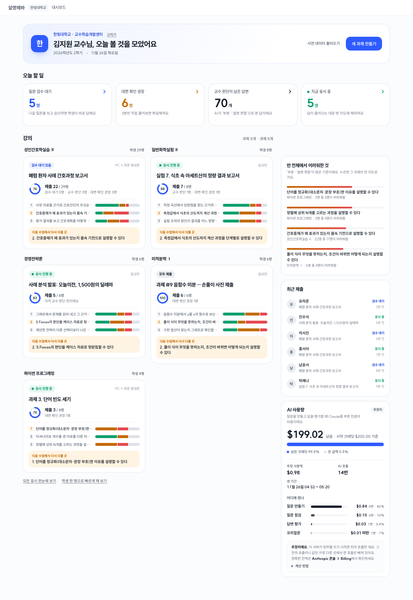
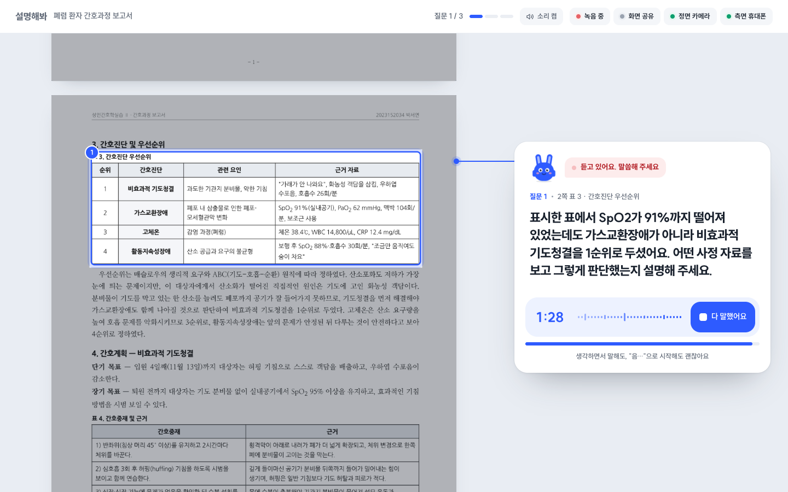
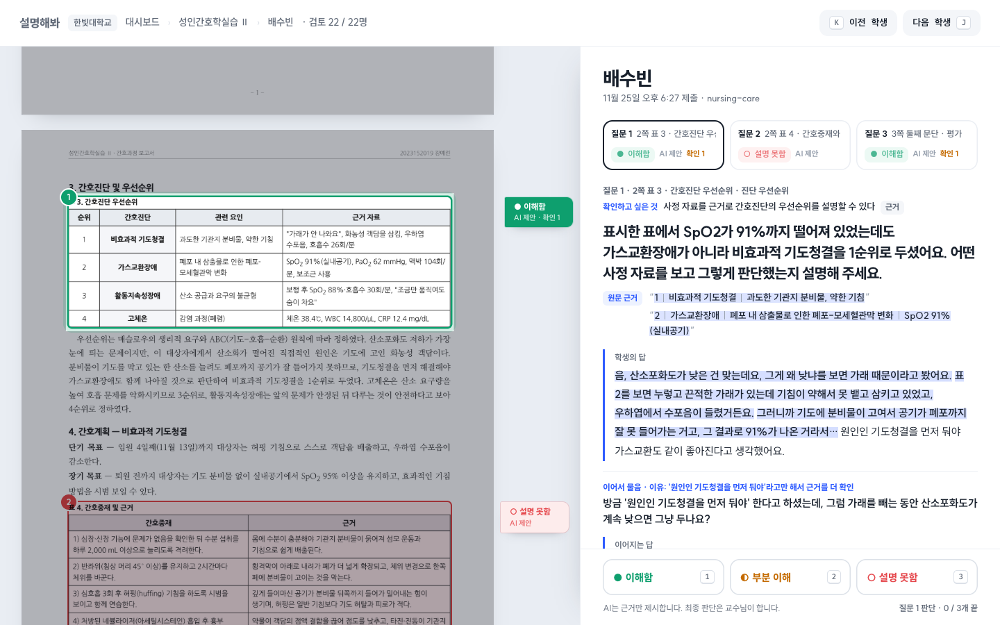

# 설명해봐

학생이 낸 과제의 한 곳을 짚어 묻고, 학생은 말로 답하고, 교수는 근거를 보고 직접 판단하는 구술 확인 서비스입니다.

## 세 가지

- **출제는 교수가 합니다.** 교수가 루브릭과 묻는 방향을 정하고, AI는 그 틀을 학생 과제의 어디에 적용할지만 찾습니다. 교수는 나갈 질문을 미리 보고 검수할 수 있습니다.
- **과제에 없는 말은 하지 않습니다.** 질문과 평가 요약이 말하는 사실은 학생 제출물에 실제로 있어야 하고, 근거 구절은 원문 그대로 보여 줍니다. AI는 근거만 제시하고 최종 판단은 교수가 합니다.
- **모든 전공에서 씁니다.** 보고서·실험 결과·발표 자료·손풀이 사진·코드. 시연 과제는 간호·화학·경영·수학 손풀이·코드입니다.

## 화면

| 교수 대시보드 | 학생 질문 화면 | 교수 리포트 |
|---|---|---|
|  |  |  |

시연 영상: 추가 예정

## 저장소

| 저장소 | 내용 |
|---|---|
| [seolmyeong-frontend](https://github.com/2026-VibeThon-AID/seolmyeong-frontend) | 교수·학생 화면 (React + TypeScript + Vite) |
| [seolmyeong-backend](https://github.com/2026-VibeThon-AID/seolmyeong-backend) | API 서버, 쪽 그림 변환, AI 연결, 근거 검사 (FastAPI) |
| [seolmyeong-docs](https://github.com/2026-VibeThon-AID/seolmyeong-docs) | 공통 지침, 설계 문서, 화면 모음 |

## 팀

| 이름 | 맡은 일 |
|---|---|
| 양희승 | 프론트엔드 |
| 최국진 | 백엔드 |
| 김준성 | 기획·AI·통합 |
